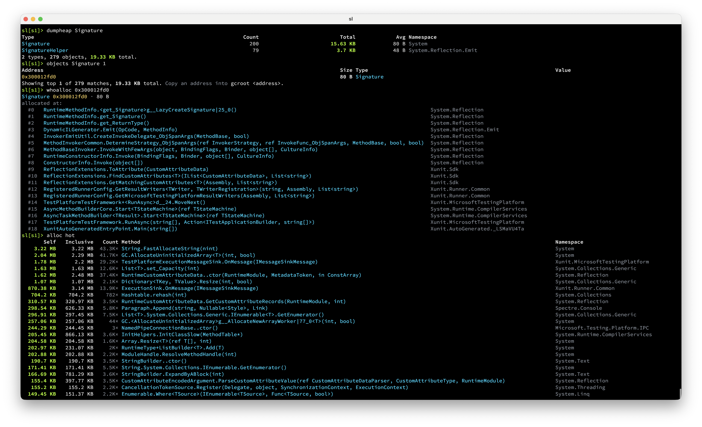
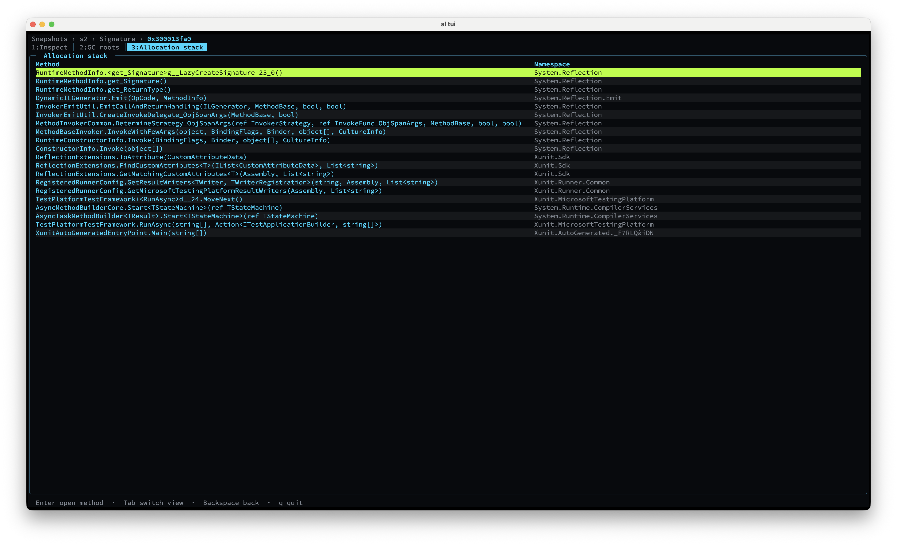

Sherlock is a terminal-first memory profiler and heap analyzer for .NET. It captures standard
managed dumps, finds retained memory, traces GC roots, and can correlate live objects with the call
stacks that allocated them.

# Installation
```bash
dotnet tool install -g sherlock-tools
```

# Usage

```text
sl run --correlate --profile --snapshot-on exit --include-process "MyApp*" -- dotnet run --project MyApp
```

```text
sl> run --correlate --profile -- dotnet run --project MyApp
sl> snapshot
sl[s1]> dominators
sl[s1]> gcroot 0x137e15ac0
sl[s1]> whoalloc 0x137e15ac0
```




<div align="center">
    <br>
</div>
